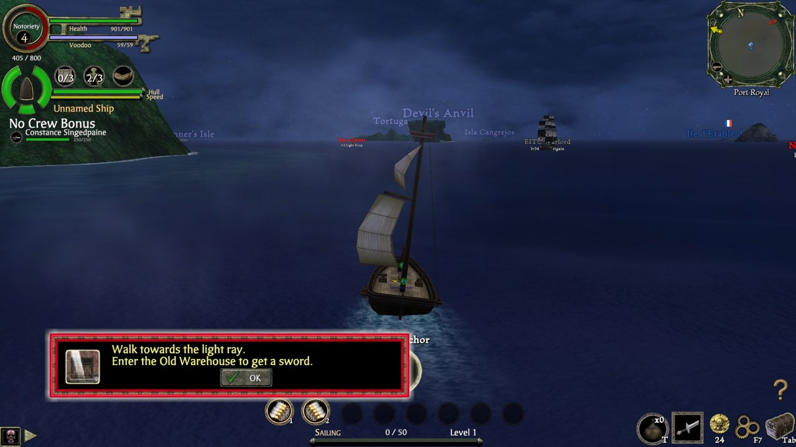
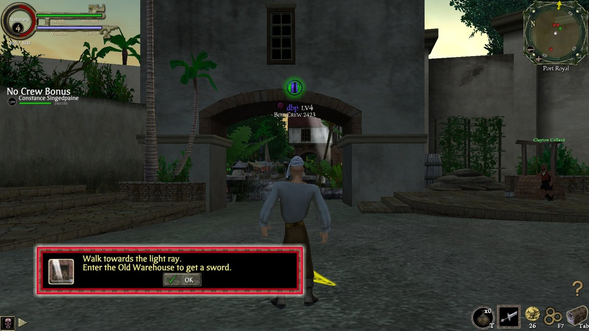

# Custom Pirates Server

My own server for Pirates of the Caribbean Online (the 2007 game), built on
[Pirates Online Classic](https://github.com/PiratesOnlineClassic/pirates-online-classic) (POC, the open-source
client and server). POC got the game running again; this server fixes what was still broken so the game can be
played end to end: crews, ships, sea battles, quests, shops, card games and friends all work. It is a non-commercial
fan project that we play on a home server, and the bots in
[Pirates Online Bots](https://github.com/DaffyDabz/pirates-online-bots) test it every day.

**Status:** playable; everything below is live on our server. · **Visibility:** private for now · **Last updated:**
2026-11-22

## Contents
- [What is in this repo](#what-is-in-this-repo)
- [What the fixes do](#what-the-fixes-do)
- [How to build it](#how-to-build-it)
- [Built with](#built-with)
- [Coming soon](#coming-soon)
- [Recent changes](#recent-changes)
- [Credits and license](#credits-and-license)

## What is in this repo

Only our own work. No game files (models, textures, sounds or phase files) are included; you need your own copy of
those.

- `patches/server-tree/`: 371 patches on top of POC, one fix per patch, in order.
- `patches/libotp-nametags.patch` and `patches/libotp/NametagConstants.py`: fixes for the pure-Python name tag
  library the game needs.
- `server/server-ctl.sh`: start, stop, restart and check the three server programs. Each runs in its own
  memory-capped space, so one that runs away restarts alone.
- `server/systemd/`: a watcher that restarts a crashed server unless it was stopped on purpose.
- `server/whos-on.py`: lists who is on the server, so a restart for a fix waits until nobody is playing.
- `server/astrond.yml`: the message server config, with players connecting on port 7100.
- `server/open-pirates-ports.ps1`: opens port 7100 in the Windows firewall so another PC on your network can join.

## What the fixes do

- **Crews and friends.** Crews can be made, joined and left. Friends can whisper each other across islands,
  teleport to each other (even inside a building), and board each other's ships from the dock rowboat.
- **Ships.** Every ship you own shows at the dock and on the Ships page. The shipwright sells, repairs and trades up
  ships. A launched ship takes a free berth instead of starting inside the island, and a full cargo hold always
  sells, whichever way the ship is put away.
- **Sea battles.** Enemy ships fire only in range, lead a moving ship and turn to fight back. Higher-level ships hit
  hard, like the original game. Open Fire!, Take Cover! and Leadership do what their text says, and repair spots
  mend at the original rate.
- **Story and quests.** The tutorial and main story play through, Tia Dalma's quests can be finished, the Black
  Pearl's barricade forts show up and can be shot down, treasure collections fill and pay, and searches and digs
  pay out.
- **Land.** Kingshead's jail works, cellar and back doors are where they belong, tonics heal, grenades work, and
  random land bosses are back on.
- **Card games.** Seven Card Stud tables next to the Hold'em tables in Port Royal and Tortuga.
- **Crashes.** Dozens of things that used to close the game or take the whole server down no longer do: logging out
  on a ship, opening the ocean list, crew chat, server restarts, quest hand-ins and more.
- **Smoother on laptops.** With only built-in graphics, the game picks the original game's lighter settings.

## How to build it

This needs some comfort with Linux and Python. It runs on Ubuntu (we use WSL on Windows).

1. Clone POC and check out the commit these patches were made on:
   `git checkout 741208881fdec30ee299b33897ef07648998faed`
2. Apply the patches in order: `git am --keep-cr /path/to/patches/server-tree/*.patch`
3. Clone [libotp-nametags](https://github.com/PiratesOnlineClassic/libotp-nametags) at commit `75adedc`, apply
   `patches/libotp-nametags.patch`, copy `patches/libotp/NametagConstants.py` into its `libotp/` folder, and link
   that folder into the POC tree as `libotp`.
4. Build POC's Astron (`astron/`) with CMake. On a modern compiler, drop `-Werror` from its `CMakeLists.txt` first.
5. Copy `server/astrond.yml` into the POC `astron/` folder.
6. Make your own `config/server.prc` from POC's and delete its `discord-bot-token` line. Never publish yours.
7. Use Python 3.9 with Panda3D 1.11 (`pip install semidbm requests`), copy `server/server-ctl.sh` next to the POC
   tree, and run `server-ctl.sh start`.
8. Get the game files from POC's own resources and point the client at your server (port 7100).

Full patch notes are in [patches/README.md](patches/README.md).

## Built with

- [Pirates Online Classic](https://github.com/PiratesOnlineClassic/pirates-online-classic), the client and server
  (Python)
- [Panda3D](https://www.panda3d.org/), the game engine
- [Astron](https://github.com/Astron/Astron), the message server

## Coming soon

- [ ] The bots play the whole main story through, as proof that it works end to end
- [ ] Ship and tattoo quest rewards
- [ ] Enemy ship speed tuned against a real player ship
- [ ] The cannon defense island's own rocks and buildings
- [ ] An easy download: a launcher and a tool that writes your server config for you

## Recent changes

- 2026-11-22 First version of this page.

## Credits and license

Pirates of the Caribbean Online and its art, names and characters belong to Disney. This is a free, non-commercial
fan project and is not affiliated with or endorsed by Disney. No game files are included.

- [Pirates Online Classic](https://github.com/PiratesOnlineClassic/pirates-online-classic) (BSD-3-Clause) is the
  base of the client and server; its license is in
  [LICENSE-pirates-online-classic.txt](LICENSE-pirates-online-classic.txt). The patches change POC's code and stay
  under its license.
- [libotp-nametags](https://github.com/PiratesOnlineClassic/libotp-nametags) by the POC team.
- [Panda3D](https://www.panda3d.org/) (BSD-3-Clause) and [Astron](https://github.com/Astron/Astron) (BSD-3-Clause).

All rights reserved for now for my own scripts in `server/`.
